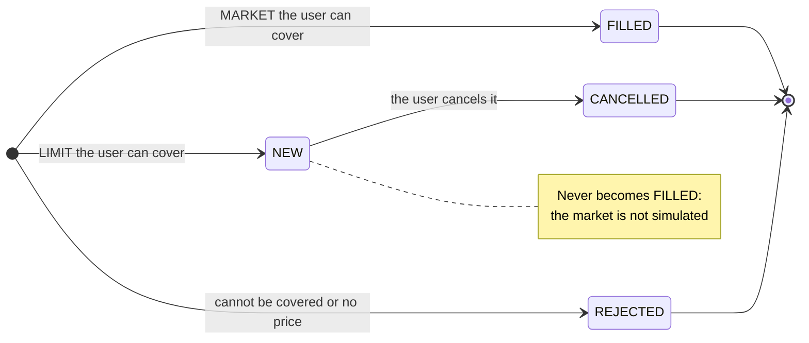
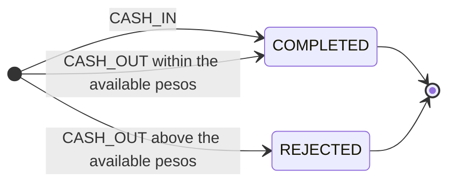

# Business decisions

What the API does and why, as seen by whoever uses it. The technical decisions are in [technical.en.md](technical.en.md), how the system would grow in [evolution.en.md](evolution.en.md) and how to run it in the [README](../README.en.md). · [Español](decisions.md)

- [Assumptions about the statement](#assumptions-about-the-statement): language, authentication, currency and the provided data.
- [Portfolio](#portfolio): total value, available pesos and returns.
- [Orders](#orders): types, rejections and cancelling.
- [Transfers](#transfers): peso deposits and withdrawals.
- [Search and listings](#search-and-listings): instruments and the user's orders.
- [Idempotency](#idempotency): what a retry guarantees.

## Assumptions about the statement

Where the statement leaves something open, or where this project departs from it, the decision is recorded here.

- **Java instead of Node.js:** the statement asks for Node.js; the company asked for it in Java, so it is Java 21 with Spring Boot.
- **No authentication:** the statement does not ask for it. The user travels in the body or the path and nothing checks that it is the caller.
- **Pesos only:** every amount is ARS, as the statement asks. The model accepts other currencies, but no rule uses them.
- **The seed is taken as it is:** order 11 sells 30 BMA with 20 held, and the portfolio shows it as a −10 position (a short, which gains when the price falls). Allowing short selling through a margin account was considered and discarded: the statement asks to check that the user holds the shares, and it would also need securities lending and collateral.
- **One account per user:** the account is a column of `users`. Co-owners are left for later ([evolution](evolution.en.md#accounts-with-co-owners)).

## Portfolio

It is computed on every request from the completed deposits and withdrawals and from the user's orders: filled ones (`FILLED`) move pesos and shares, and open ones (`NEW`) only reserve them. Positions come ordered by ticker.

- **Available pesos:** cash minus what open limit buys reserve, because that can no longer be used to trade. The total value does include it, because it still belongs to the user.
- **Total return:** measured against the exact average cost, which a partial sale does not change. On a short it is positive when the price went down.
- **Daily return:** compares `close` with `previousClose`. Both returns are percentages, with 2 decimals.
- **No price:** if a held instrument has no market data, its value and returns are `null` and do not add to the total.

## Orders

A market order (`MARKET`) executes at the latest `close` and is `FILLED`. A limit order (`LIMIT`) stays `NEW` at its own price and reserves pesos or shares until it is cancelled: the market is not simulated, so nothing matches it against a price. An order for an amount of pesos buys whole shares only. The `side` is `BUY` or `SELL`, and the time (`datetime`) is returned in UTC (ISO-8601).

- **400 or `REJECTED`:** a request that makes no sense (broken JSON, a fractional size, both size and amount or neither, a limit order without a price or a market order with one, a `side` such as `CASH_IN`, trading the peso instrument) is a 400 and stores nothing. A user or an instrument that does not exist is a 404.
- **Rejections:** a valid order the user cannot cover is stored `REJECTED` and answered with 201, because that is how the statement describes it: the market rejects it and it stays in the history. The reasons are `INSUFFICIENT_CASH`, `INSUFFICIENT_SHARES` (counting open sells), `AMOUNT_BELOW_ONE_SHARE` (it depends on the price at that moment, which is why it is not a 400) and `NO_MARKET_DATA`.
- **The reason is stored** in `rejectionReason`, so rejections can be audited; it is `null` for every other order.
- **Cancelling:** only a `NEW` order; any other answers 409 `ORDER_NOT_CANCELLABLE`. Cancelling releases what the order reserved.
- **Cancelling does not check the owner:** without authentication, a `userId` sent by the client would only look like security.

## Transfers

A deposit or a withdrawal of pesos is a transfer, with its own endpoint (`/users/{userId}/transfers`), not an order. The statement allows modelling them as orders; this project departs from that on purpose, because a transfer has no instrument, price or market, and as an order those columns had to hold placeholders and every order rule had to exclude it.

- **Same vocabulary:** the type is `CASH_IN` or `CASH_OUT`, the statement's names. The seed's cash movements became transfers, with their time, and the portfolio did not change.
- **Rejected withdrawals:** a `CASH_OUT` above the available pesos (open limit buys keep what they reserve) is stored `REJECTED` with `rejectionReason` `INSUFFICIENT_CASH` and answered with 201, like a rejected order.
- **400:** an amount that is not positive or has more than 2 decimals stores nothing.
- **History:** `GET /users/{userId}/transfers` returns them newest first. Another user's transfer answers 404, like one that does not exist.

## Search and listings

`GET /instruments?query=` searches the text in the ticker or the name, ignoring case and accents ("compania" finds "Compañía"), ordered by ticker. It returns a page, not the whole list.

- **The peso is left out:** it is the account's cash, not an asset you buy.
- **Literal text:** `%` and `_` are searched as text, not as wildcards. An empty `query` or one longer than 100 characters is a 400.
- **Types in English:** `STOCK` and `CURRENCY`, although the database stores `ACCIONES` and `MONEDA`.
- **Pagination:** `page` (from 0) and `size` (default 20, maximum 100; a larger one is capped to 100). The response is `{"content": [...], "page": {"size", "number", "totalElements", "totalPages"}}`. The order is fixed and a client `sort` is ignored.
- **The user's orders:** `GET /users/{userId}/orders` returns them newest first (for the same time, the higher id first), with the same pagination and the same format as a single order. An optional `status` filters by state; a state that does not exist is a 400 and an unknown user a 404.

## Idempotency

A client that retries after a timeout does not know whether its request arrived, and in a brokerage a retry must not buy or withdraw twice. `POST /orders` and `POST /users/{userId}/transfers` take an optional `Idempotency-Key` header, with the semantics of the IETF draft "The Idempotency-Key HTTP Header Field". Without the header nothing changes.

- **What it guarantees:** a retry with the same key returns the same order or transfer, as it is now (an order cancelled since then shows `CANCELLED`), instead of creating another. A rejection is a result too: it comes back `REJECTED`, without deciding again. A request that fails (400, 404) stores nothing and its key stays free.
- **How to tell:** the retry answers 201 with `Idempotent-Replayed: true`.
- **Another request with the same key** is a 422 `IDEMPOTENCY_KEY_REUSED` and stores nothing. What is compared is the parsed request, so field order, spacing or `1000` against `1000.00` do not change it.
- **Scope:** a key holds for at least 24 hours, per user and per operation (placing an order or making a transfer). It is 1 to 64 characters of `[A-Za-z0-9._:-]`, quoted or not (`"abc"` is `abc`), because the draft defines it as a structured-field string.
- **The weak point:** the client has to keep the key and send the same one again; if it loses it, the retry is a new order. Detecting duplicates on the server by comparing the operation's fields was discarded, because it would also block two legitimate identical orders (buying 10 PAMP twice in a row).
