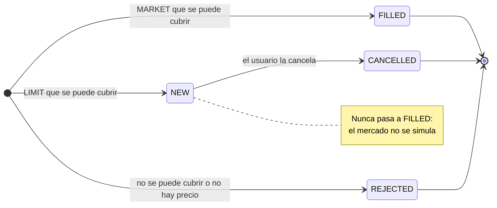
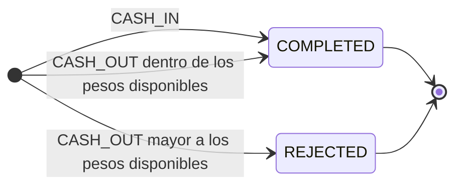

# Decisiones de negocio

Qué hace la API y por qué, visto desde quien la usa. Las decisiones técnicas están en [technical.md](technical.md), cómo crecería el sistema en [evolution.md](evolution.md) y cómo levantarlo en el [README](../README.md). · [English](decisions.en.md)

- [Supuestos sobre el enunciado](#supuestos-sobre-el-enunciado): lenguaje, autenticación, moneda y datos provistos.
- [Portfolio](#portfolio): valor total, pesos disponibles y rendimientos.
- [Órdenes](#órdenes): tipos, rechazos y cancelación.
- [Transferencias](#transferencias): depósitos y retiros de pesos.
- [Búsqueda y listados](#búsqueda-y-listados): instrumentos y órdenes del usuario.
- [Idempotencia](#idempotencia): qué garantiza un reintento.

## Supuestos sobre el enunciado

Donde el enunciado deja algo abierto, o donde este proyecto se aparta de él, la decisión queda acá.

- **Java en lugar de Node.js:** el enunciado pide Node.js; la empresa pidió hacerlo en Java, así que es Java 21 con Spring Boot.
- **Sin autenticación:** el enunciado no la pide. El usuario viaja en el cuerpo o en la ruta y nada verifica que sea quien llama.
- **Solo pesos:** todos los importes son ARS, como pide el enunciado. El modelo admite otras monedas, pero ninguna regla las usa.
- **El seed se toma como está:** la orden 11 vende 30 BMA con 20 en cartera, y el portfolio lo muestra como una posición de −10 (un corto, que gana si el precio baja). Se evaluó permitir ventas en corto con una cuenta de margen y se descartó: el enunciado pide validar que el usuario tenga las acciones, y además requeriría préstamo de títulos y garantías.
- **Una cuenta por usuario:** la cuenta es una columna de `users`. Los cotitulares quedan para más adelante ([evolución](evolution.md#cuentas-con-cotitulares)).

## Portfolio

Se calcula en cada consulta a partir de los depósitos y retiros completados y de las órdenes del usuario: las ejecutadas (`FILLED`) mueven pesos y acciones, y las abiertas (`NEW`) solo los reservan. Las posiciones salen ordenadas por ticker.

- **Pesos disponibles:** el cash menos lo que reservan las compras límite abiertas, porque eso ya no se puede usar para operar. El valor total sí lo incluye, porque sigue siendo del usuario.
- **Rendimiento total:** se mide contra el costo promedio exacto, que una venta parcial no cambia. En un corto es positivo cuando el precio bajó.
- **Rendimiento diario:** compara `close` con `previousClose`. Los dos rendimientos van en porcentaje, con 2 decimales.
- **Sin precio:** si un instrumento en cartera no tiene market data, su valor y sus rendimientos vienen en `null` y no suman al total.

## Órdenes

Una orden de mercado (`MARKET`) se ejecuta al último `close` y queda `FILLED`. Una límite (`LIMIT`) queda `NEW` a su precio y reserva pesos o acciones hasta que se cancela: el mercado no se simula, así que nada la cruza contra un precio. Una orden por monto en pesos compra solo acciones enteras. El `side` es `BUY` o `SELL`, y la hora (`datetime`) se devuelve en UTC (ISO-8601).

- **400 o `REJECTED`:** un pedido que no tiene sentido (JSON roto, una cantidad fraccionaria, cantidad y monto a la vez o ninguno, una límite sin precio o una de mercado con precio, un `side` como `CASH_IN`, operar el instrumento de pesos) es un 400 y no guarda nada. Un usuario o un instrumento que no existe es un 404.
- **Rechazos:** una orden válida que el usuario no puede cubrir se guarda `REJECTED` y responde 201, porque así la describe el enunciado: el mercado la rechaza y queda en el historial. Los motivos son `INSUFFICIENT_CASH`, `INSUFFICIENT_SHARES` (contando las ventas abiertas), `AMOUNT_BELOW_ONE_SHARE` (depende del precio del momento, por eso no es un 400) y `NO_MARKET_DATA`.
- **El motivo se guarda** en `rejectionReason`, para poder auditar los rechazos; es `null` en las demás órdenes.
- **Cancelar:** solo una orden `NEW`; cualquier otra responde 409 `ORDER_NOT_CANCELLABLE`. Cancelar libera lo que la orden reservaba.
- **Cancelar no verifica al dueño:** sin autenticación, un `userId` enviado por el cliente solo parecería seguridad.

## Transferencias

Un depósito o un retiro de pesos es una transferencia, con su endpoint propio (`/users/{userId}/transfers`), no una orden. El enunciado permite modelarlas como órdenes; este proyecto se aparta a propósito, porque una transferencia no tiene instrumento, precio ni mercado, y como orden había que llenar esas columnas con valores de relleno y excluirla de cada regla de órdenes.

- **Mismo vocabulario:** el tipo es `CASH_IN` o `CASH_OUT`, los nombres del enunciado. Los movimientos de pesos del seed pasaron a ser transferencias, con su hora, y el portfolio no cambió.
- **Retiros rechazados:** un `CASH_OUT` mayor a los pesos disponibles (las compras límite abiertas siguen reservando lo suyo) se guarda `REJECTED` con `rejectionReason` `INSUFFICIENT_CASH` y responde 201, igual que una orden rechazada.
- **400:** un monto que no es positivo o tiene más de 2 decimales no guarda nada.
- **Historial:** `GET /users/{userId}/transfers` las devuelve de la más nueva a la más vieja. Una transferencia de otro usuario responde 404, igual que una que no existe.

## Búsqueda y listados

`GET /instruments?query=` busca el texto en el ticker o en el nombre, sin distinguir mayúsculas ni acentos ("compania" encuentra "Compañía"), y ordena por ticker. Devuelve una página, no la lista entera.

- **El peso no aparece:** es la caja de la cuenta, no un activo que se compre.
- **Texto literal:** `%` y `_` se buscan como texto, no como comodines. Un `query` vacío o de más de 100 caracteres es un 400.
- **Tipos en inglés:** `STOCK` y `CURRENCY`, aunque la base guarde `ACCIONES` y `MONEDA`.
- **Paginación:** `page` (desde 0) y `size` (20 por defecto, máximo 100; uno mayor se recorta a 100). La respuesta es `{"content": [...], "page": {"size", "number", "totalElements", "totalPages"}}`. El orden es fijo y un `sort` del cliente se ignora.
- **Órdenes del usuario:** `GET /users/{userId}/orders` las devuelve de la más nueva a la más vieja (a igual hora, la de id mayor primero), con la misma paginación y el mismo formato que una orden sola. `status` opcional filtra por estado; un estado que no existe es un 400 y un usuario desconocido, un 404.

## Idempotencia

Un cliente que reintenta después de un timeout no sabe si su pedido llegó, y en un broker un reintento no puede comprar ni retirar dos veces. `POST /orders` y `POST /users/{userId}/transfers` aceptan un header opcional `Idempotency-Key`, con la semántica del draft de la IETF "The Idempotency-Key HTTP Header Field". Sin el header nada cambia.

- **Qué garantiza:** un reintento con la misma clave devuelve la misma orden o transferencia, como está ahora (una orden cancelada después aparece `CANCELLED`), en lugar de crear otra. Un rechazo también es un resultado: vuelve `REJECTED`, sin decidir de nuevo. Un pedido que falla (400, 404) no guarda nada y su clave sigue libre.
- **Cómo se reconoce:** el reintento responde 201 con `Idempotent-Replayed: true`.
- **Otro pedido con la misma clave** es un 422 `IDEMPOTENCY_KEY_REUSED` y no guarda nada. Se compara el pedido ya interpretado, así que el orden de los campos, los espacios o `1000` contra `1000.00` no lo cambian.
- **Alcance:** la clave vale al menos 24 horas, por usuario y por operación (enviar una orden o hacer una transferencia). Son 1 a 64 caracteres de `[A-Za-z0-9._:-]`, con o sin comillas (`"abc"` es `abc`), porque el draft la define como un string de structured fields.
- **El punto débil es que la clave la pone el cliente:** tiene que generarla, guardarla y reenviar la misma; si la pierde, el reintento es una orden nueva. Se evaluó una huella del lado del servidor, armada con los campos de la operación (usuario, instrumento, lado, cantidad o monto y precio, dentro de una ventana corta): no le pide nada al cliente, pero también bloquearía dos órdenes idénticas legítimas (comprar 10 PAMP dos veces seguidas). Se eligió la clave del cliente, y la huella queda como posible complemento.
