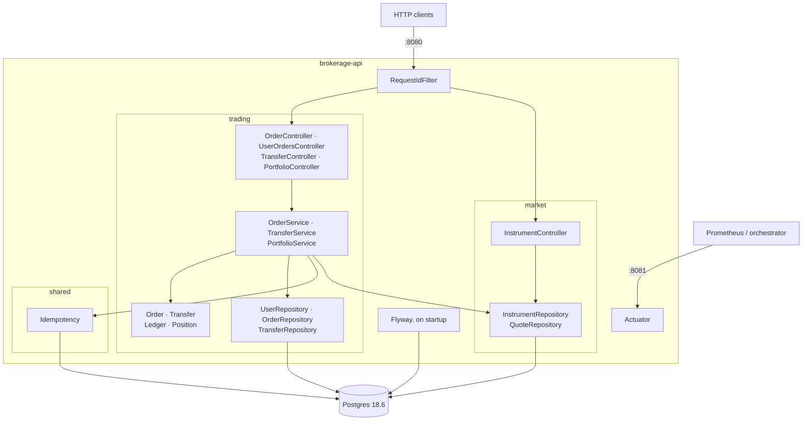
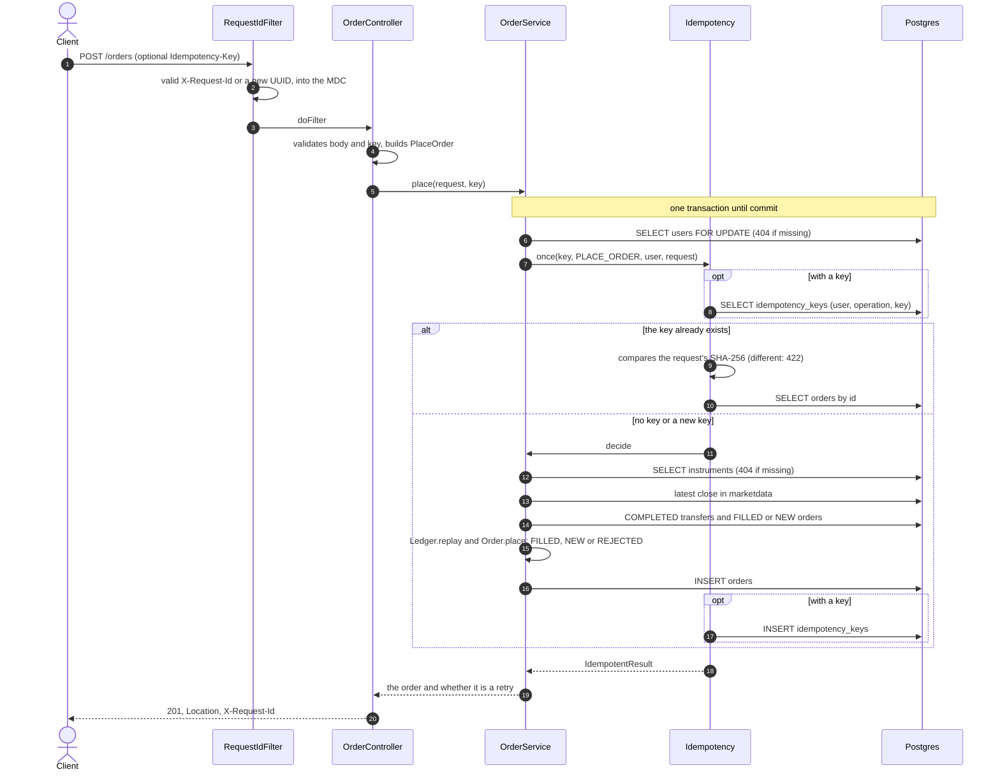
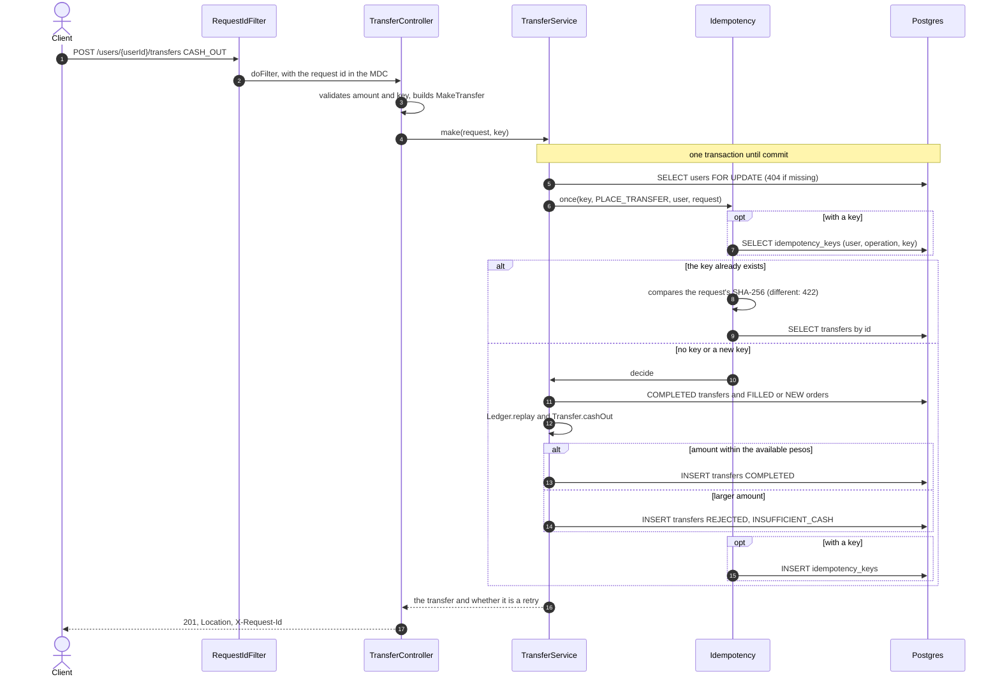

# Technical decisions

How the project is built and why. What the API does, and why, is in [decisions.en.md](decisions.en.md); how it would grow, in [evolution.en.md](evolution.en.md). · [Español](technical.md)

- [Architecture](#architecture): style, modules and discarded alternatives.
- [Flows](#flows): the path of an order and of a withdrawal.
- [Money](#money): `Money`, precision and rounding.
- [Database](#database): migrations on top of the provided schema.
- [Concurrency](#concurrency): what is locked and how it is tested.
- [Errors](#errors): domain exceptions and problem details.
- [Idempotency](#idempotency): table, request hash and retention.
- [Logs and observability](#logs-and-observability): request id, formats, metrics and probes.
- [Deployment and CI](#deployment-and-ci): image, configuration and pipeline.
- [Tests](#tests): layers and rules.

## Architecture

The system has two halves with different needs, and each uses the style that fits it. Placing and cancelling orders, or moving pesos, is a problem of rules (states, rejections, balance), so it is modelled with DDD. The portfolio, the search and the listings are reads: they are computed from the data, with no rules to protect.

- **Writes (DDD):** `Order` and `Transfer` are aggregates that decide their own status (`Order.place`, `Order.cancel`, `Transfer.cashOut`). They decide against a `Ledger`, the user's cash and positions rebuilt from the transfers and the orders; `Position` keeps the average cost.
- **Reads (projection):** the portfolio is the same `Ledger` valued at the latest price. The search projects the query straight into `InstrumentView`, with no service; the order listing pages with Spring Data, and pages are serialised in their stable shape (`{content, page}`), not with the internals of `PageImpl`.
- **No isolated domain layer:** the JPA entities are the model. Separating them from Spring would add ports and mappers with no benefit at this size.
- **Modules:** `market` (instruments and prices), `trading` (users, transfers, orders and portfolio) and `shared` (money, errors, request id and, in `shared.idempotency`, idempotency). `trading` uses `market` and `shared`, `market` uses `shared`, and `shared` uses neither.

| Decision | Chosen | Discarded | Why |
|---|---|---|---|
| Style | Hybrid: DDD for writes, projections for reads | Hexagonal with ports and adapters | The rules live in the aggregates either way; ports and adapters would only add layers at this size. |
| Write side | Aggregates with behaviour | Purely data-driven: services over data without rules | States and rejections stay in one place and are tested without a database or Spring. |
| Model | JPA entities | Separate domain model and mappers | It would duplicate every type and its conversion without changing any rule. |
| Concurrency | Pessimistic lock on the user's row | Optimistic locking (`@Version`) | The balance is derived from many rows and two orders write different rows: a per-row version does not see the conflict, and every clash would have to be retried. Waiting for the lock is simpler and only operations of the same user compete. |
| Currency | `java.util.Currency` inside our own `Money` | JSR 354 (Moneta) | There is one currency and no conversion; Moneta comes with several currencies ([evolution](evolution.en.md#several-currencies)). |
| Schema | Flyway with a baseline at version 1 | Manual scripts, or no migrations (`ddl-auto`) | The local database, the tests and the provided database follow the same path, versioned and repeatable. |
| Transfers | Their own `transfers` table | `CASH_IN`/`CASH_OUT` orders | A transfer has no instrument, price or market; as an order those columns held placeholders and every order rule had to exclude it. |
| Idempotency | `Idempotency-Key` sent by the client | Server-side fingerprint of the operation's fields | The fingerprint would also block two legitimate identical orders; the key states the client's intent, as in the IETF draft. |
| Tests | Testcontainers with Postgres 18.6 | H2 or mocks | The code uses Postgres on purpose (`distinct on`, `FOR UPDATE`, `timestamptz`, `unaccent`, `pg_trgm`); testing on another database would test something else. |

## Flows

The two paths that write money share their shape: one transaction that locks the user, resolves the idempotency key and only then decides against the `Ledger`. The diagrams follow the code.

- **Order:** `OrderController` validates the body and the header, and `PlaceOrder` rejects invalid combinations before the transaction opens. The decision belongs to `Order.place`; the service only gathers the instrument, the latest `close` and the `Ledger`.
- **Withdrawal:** `Transfer.cashOut` decides against the available pesos; a deposit (`CASH_IN`) takes the same lock but does not rebuild the `Ledger`.
- **Response:** always 201 with `Location`, and `Idempotent-Replayed: true` when it is a retry.

## Money

Every amount is a `Money`, a record of `java.util.Currency` and `BigDecimal`, never a bare number or a `double`. Today there are only pesos, but no signature assumes it.

- **Precision:** sums and products are exact; divisions (average cost, returns) use `MathContext.DECIMAL64`, 16 significant digits.
- **Rounding when presenting:** `Money.rounded()` brings the amount to the currency's decimals (2 for ARS), half-even, and only the response views call it. Percentages are rounded the same way, to 2 decimals.
- **Value equality:** 10.5 ARS equals 10.50 ARS, unlike `BigDecimal.equals`.
- **No mixing:** combining different currencies throws `CurrencyMismatchException`; there is never an implicit conversion. It is a programming error, not the client's, so it surfaces as a 500.
- **Columns without currency:** the provided schema stores prices and amounts without a currency, and they are read as ARS (`Currencies.ARS`). Another currency would need that column.

## Database

The provided schema is version 1. Flyway takes any database without history as version 1 (`baseline-on-migrate`) and applies the pending migrations on startup, so the local database, the tests and the provided database follow the same path. Hibernate only validates (`ddl-auto: validate`).

- **The first run against the provided database alters it:** it adds indexes (V2, V5, V6, V7) and the orders' `rejectionReason` column (V3), turns `orders.datetime` into `timestamptz` (V4), creates `transfers` and moves the cash movements into it (V5), enables `unaccent` and `pg_trgm` (V6), creates `idempotency_keys` (V7) and creates `flyway_schema_history`.
- **Same version and a direct connection:** Postgres 18.6, the version of the provided database, locally and in the tests. The connection is direct, not a transaction-mode pooler: migrations need a stable session.
- **Provided state untouched:** `db/01-database.sql` is never edited; the local and test databases load it when they are created. The database values (`ACCIONES`, `MONEDA`) are translated by a converter, so the table's vocabulary does not leak into the model.
- **Time:** instants are `timestamptz`, come from a single UTC `Clock` that tests fix, and are stored truncated to seconds. The provided orders held Buenos Aires time without a zone (11:13 to 16:11, the local market hours), and V4 read them that way, once.
- **Accent-insensitive search:** `unaccent` and `pg_trgm` are *trusted* extensions, created by the database owner without a superuser. `unaccent` is only `STABLE` because it reads a dictionary, and an index requires `IMMUTABLE`: the `immutable_unaccent` wrapper pins the dictionary by name. There are GIN trigram indexes on ticker and name, and the query repeats that exact expression; the function is registered in Hibernate as a string so it is not wrapped in a cast that would keep the index from being used. With 66 instruments the planner may still prefer scanning the table.

| Version | What it does |
|---|---|
| V2 | Indexes for orders by user and status, and for the latest price per instrument. |
| V3 | `rejectionReason` column on `orders`. |
| V4 | `orders.datetime` becomes `timestamptz`, reading the provided values as Buenos Aires time. |
| V5 | `transfers` table; moves the `CASH_IN`/`CASH_OUT` rows out of `orders` (`FILLED` to `COMPLETED`, `REJECTED` unchanged, any other status stops the migration) and restricts `side` to `BUY` and `SELL`, all in one transaction. |
| V6 | `unaccent` and `pg_trgm` extensions, `immutable_unaccent` and the trigram search indexes. |
| V7 | `idempotency_keys` table, with its unique constraint and an index by date for the purge. |

## Concurrency

Everything that spends or moves a user's pesos or shares first takes a pessimistic lock on their row (`SELECT ... FOR UPDATE` on `users`) and holds it until commit. Two operations of the same user are decided one after the other, each against a `Ledger` that already includes the previous one.

- **Orders and transfers:** placing an order, depositing and withdrawing take the same lock, so a buy and a withdrawal at the same time cannot spend the same pesos.
- **Idempotency:** the key is looked up and stored under that lock; `Idempotency.once` requires an open transaction (`MANDATORY`).
- **Cancelling:** locks only the order's row, so two cancels cannot both see it open. An order decided while another is being cancelled still sees it `NEW` and counts its reservation: it may reject too much, never spend too much.
- **Reads:** the portfolio, the search and the listings lock nothing.
- **Tests:** `ConcurrentOrdersTest` releases two operations at once with a `CountDownLatch`: two buys that do not fit together, two cancels, a withdrawal and a buy, and two retries with the same key (order and withdrawal).

## Errors

Every error response is a problem detail (RFC 9457) with a stable `code` and the request's `requestId`. A client switches on the `code`, and support finds the logs with the `requestId`.

- **Domain exceptions:** `DomainException` is sealed, with four categories: `NotFoundException` (404), `InvalidRequestException` (400), `ConflictException` (409) and `UnprocessableContentException` (422: the request contradicts an earlier one; not a 409 because retrying cannot fix it, only changing the request can). They do not know what HTTP is, and a new category does not compile until it is given a status.
- **Stable codes:** each exception carries an `ErrorCode` (`ORDER_NOT_FOUND`, `ORDER_NOT_CANCELLABLE`, `IDEMPOTENCY_KEY_REUSED`...). A code is never renamed or given a new meaning; the text can change.
- **One translator:** `ApiExceptionHandler` is the only place that turns exceptions into responses. Validation is a 400 `VALIDATION_FAILED` with `errors` (`{field, message}`, and a header is named as the client sends it); broken JSON is `MALFORMED_REQUEST` and does not repeat Jackson's message.
- **Framework errors** (method not allowed, unknown route) keep their status and gain the `requestId`, without a `code`.
- **A 500 never leaks internals:** it answers `INTERNAL_ERROR` with a generic text asking to quote the `requestId`; the message and stack stay in the log, at ERROR level.

## Idempotency

`Idempotency.once` wraps the creation of an order or a transfer: without a key it just creates; with a key, it looks for what that key already created and, if nothing, creates and records it. It follows the IETF draft "The Idempotency-Key HTTP Header Field".

- **Table:** `idempotency_keys` (V7) stores user, operation (`PLACE_ORDER` or `PLACE_TRANSFER`), key, request hash, resource id and date. `resourceId` has no foreign key because it points at an order or a transfer depending on the operation.
- **Request hash:** `Fingerprint` is a SHA-256 of the parsed command (`PlaceOrder`, `MakeTransfer`), not of the bytes. It walks every record component, so a new field can never be left out of the comparison, and it normalises decimals (`1000` is `1000.00`).
- **Inside the lock:** the lookup and the insert run under the user's lock, so a concurrent retry waits for the first request and finds its key. That is why the 409 the draft foresees for a request in flight is not needed; the unique constraint on (user, operation, key) is the safety net.
- **A retry reads the current resource:** the response is not stored, only the id; storing responses would duplicate what `orders` and `transfers` already hold. If the creation fails, the whole transaction rolls back and the key stays free.
- **Retention:** `Idempotency.RETENTION` is 24 hours and an hourly `@Scheduled` task deletes older keys, so a key may live up to an hour longer. Every instance may run it: deleting the same rows twice does no harm.

## Logs and observability

Each request carries an id that appears on all its log lines and comes back in the response and in every error, to follow a call end to end. Metrics and probes are served apart from the API.

- **Validated request id:** the client's `X-Request-Id` is used only when it is 1 to 64 characters of `[A-Za-z0-9._-]`; otherwise a UUID is generated. That way a client cannot inject line breaks or fake text into the logs.
- **Formats:** readable text by default, with the id in brackets on every line; the `json` profile emits ECS-format JSON (Spring Boot's built-in support), with the id as the `requestId` field.
- **Prometheus on the management port:** Actuator is served on 8081 and the API on 8080, so metrics and probes are not exposed through the API's ingress. `/actuator/prometheus` publishes the JVM, HTTP requests, the Hikari pool and Tomcat, tagged `application=brokerage-api`, with no custom metrics code.
- **Probes:** readiness includes the database and liveness does not: a database outage takes the instance out of traffic but does not restart it.
- **No distributed tracing and no business events:** with a single service tracing is not worth its cost; logs and metrics for orders and transfers are in [evolution](evolution.en.md#business-metrics-and-logs).

## Deployment and CI

The application is deployed as a container image, layered so a code change only rebuilds the last layer. CI runs on every pull request and on every push to `main`, and only `main` publishes.

- **Image:** it compiles with Temurin's JDK 21 and runs on Temurin's JRE 21 on Alpine, with an unprivileged user (uid 10001) and the heap sized from the container's memory limit (`MaxRAMPercentage=75`). Layers go from least to most frequently changing: dependencies, loader, snapshots and code.
- **Configuration:** only through environment variables (`DB_URL`, `DB_USERNAME`, `DB_PASSWORD`); the image carries no secrets. Locally, an optional `.env` outside git, which real variables override.
- **Jobs:** `Test (mvn verify)` and `Build image`, which runs after it. `main` requires both checks and a pull request (with no mandatory approvals) and allows neither force pushes nor deletion; administrators can bypass these rules.
- **Trivy:** scans the image before publishing and fails on critical vulnerabilities that have a fix.
- **GHCR:** `main` publishes `ghcr.io/sebastiancuccorese/brokerage-api` with the tags `latest` and the commit SHA.

## Tests

`./mvnw verify` runs everything against a throwaway Postgres 18.6 (Testcontainers) loaded with `db/01-database.sql` and migrated by Flyway, like the local database. It needs Docker and never touches a shared database.

- **Unit tests on the domain:** `Order`, `Transfer`, `Position`, `PlaceOrder`, `Money` and idempotency are tested with real objects, without Spring or a database; a `Ledger` is built with `Ledger.replay` from real transfers and orders.
- **Functional tests:** `@SpringBootTest` with `MockMvcTester` against the Testcontainers Postgres; probes and metrics with an HTTP client against the real ports.
- **No mocks, no waiting:** no test uses mocks, of the domain or of anything else, and none sleeps: concurrency synchronises on latches and time comes from a fixed `Clock`.
- **Seed untouched:** `TestAccounts` creates a new user per test, with real deposits and inserted filled buys, so no test touches the seed users, whose exact portfolio `PortfolioTest` checks.
- **The required functional test:** `OrdersTest` places orders over HTTP and checks execution at the latest `close` and its effect on the portfolio, the limit order that reserves, the buy by amount, each rejection reason, the 400s that store nothing, the 404s, reading back and cancelling.
