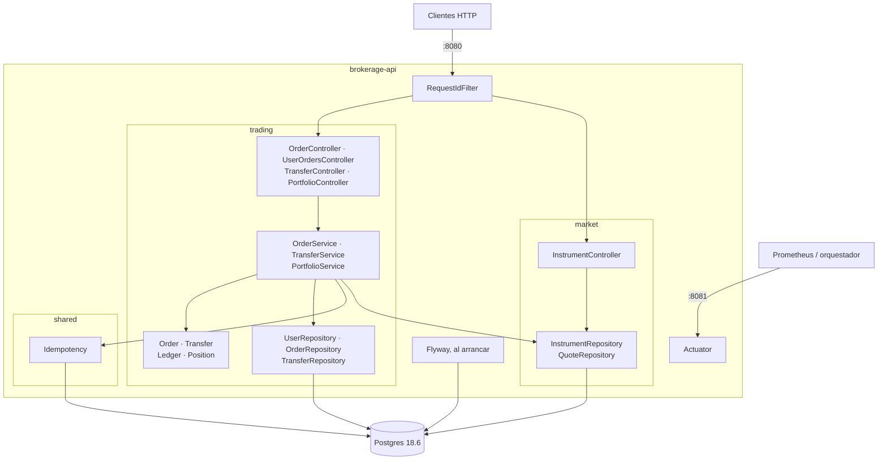
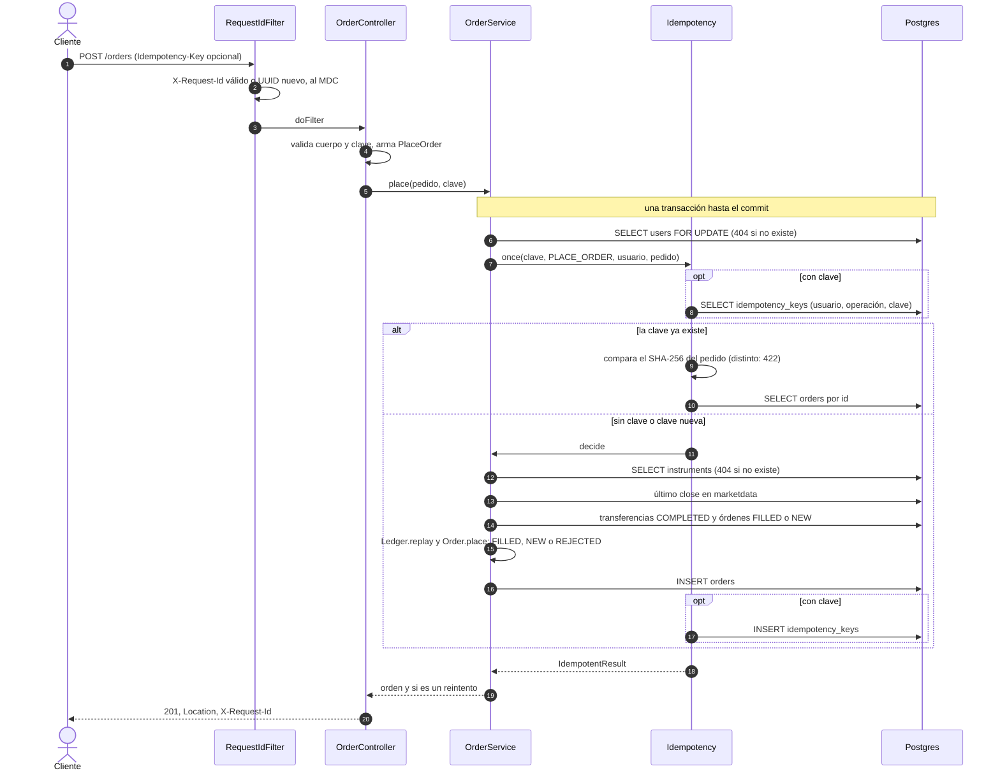
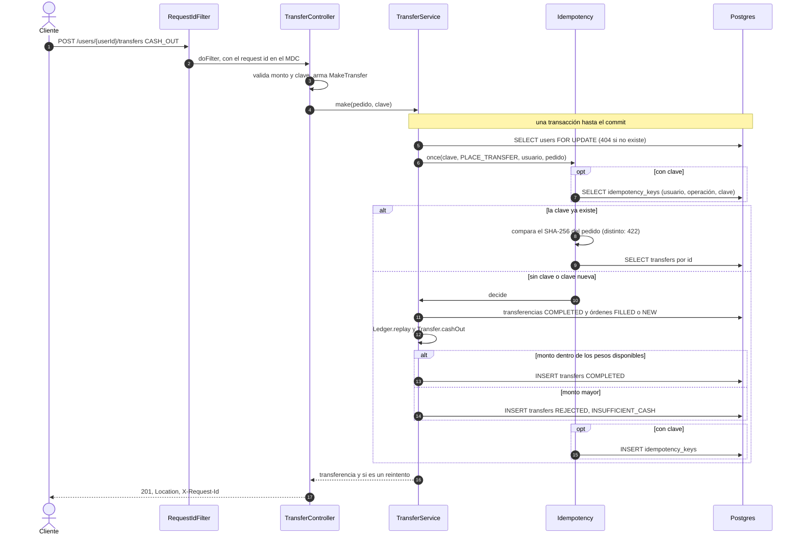

# Decisiones técnicas

Cómo está construido el proyecto y por qué. Qué hace la API, y por qué, está en [decisions.md](decisions.md); cómo crecería, en [evolution.md](evolution.md). · [English](technical.en.md)

- [Arquitectura](#arquitectura): estilo, módulos y alternativas descartadas.
- [Flujos](#flujos): el camino de una orden y de un retiro.
- [Dinero](#dinero): `Money`, precisión y redondeo.
- [Base de datos](#base-de-datos): migraciones sobre el esquema provisto.
- [Concurrencia](#concurrencia): qué se bloquea y cómo se prueba.
- [Errores](#errores): excepciones de dominio y problem details.
- [Idempotencia](#idempotencia): tabla, hash del pedido y retención.
- [Logs y observabilidad](#logs-y-observabilidad): request id, formatos, métricas y probes.
- [Despliegue y CI](#despliegue-y-ci): imagen, configuración y pipeline.
- [Tests](#tests): capas y reglas.

## Arquitectura

El sistema tiene dos mitades con necesidades distintas, y cada una usa el estilo que le sirve. Enviar y cancelar órdenes, o mover pesos, es un problema de reglas (estados, rechazos, saldo), así que se modela con DDD. El portfolio, la búsqueda y los listados son lecturas: se calculan a partir de los datos, sin reglas que proteger.

- **Escritura (DDD):** `Order` y `Transfer` son agregados que deciden su propio estado (`Order.place`, `Order.cancel`, `Transfer.cashOut`). Deciden contra un `Ledger`, el cash y las posiciones del usuario reconstruidos desde las transferencias y las órdenes; `Position` lleva el costo promedio.
- **Lectura (proyección):** el portfolio es el mismo `Ledger` valuado al último precio. La búsqueda proyecta la consulta directo a `InstrumentView`, sin servicio; el listado de órdenes pagina con Spring Data.
- **Sin capa de dominio aislada:** las entidades JPA son el modelo. Separarlas de Spring agregaría puertos y mappers sin beneficio a este tamaño.
- **Módulos:** `market` (instrumentos y precios), `trading` (usuarios, transferencias, órdenes y portfolio) y `shared` (dinero, errores, request id y, en `shared.idempotency`, la idempotencia). `trading` usa `market` y `shared`, `market` usa `shared`, y `shared` no usa a ninguno.

| Decisión | Elegida | Descartada | Por qué |
|---|---|---|---|
| Estilo | Híbrido: DDD al escribir, proyecciones al leer | Hexagonal con puertos y adaptadores | Las reglas viven igual en los agregados; los puertos y adaptadores solo agregarían capas a este tamaño. |
| Lado de escritura | Agregados con comportamiento | Puramente data-driven: servicios sobre datos sin reglas | Los estados y los rechazos quedan en un solo lugar y se prueban sin base ni Spring. |
| Modelo | Entidades JPA | Modelo de dominio separado y mappers | Duplicaría cada tipo y su conversión sin cambiar ninguna regla. |
| Concurrencia | Bloqueo pesimista de la fila del usuario | Optimistic locking (`@Version`) | El saldo se deriva de muchas filas y dos órdenes escriben filas distintas: una versión por fila no ve el conflicto, y cada choque habría que reintentarlo. Esperar el bloqueo es más simple y solo compiten las operaciones de un mismo usuario. |
| Moneda | `java.util.Currency` dentro de un `Money` propio | JSR 354 (Moneta) | Hay una sola moneda y ninguna conversión; Moneta entra con varias monedas ([evolución](evolution.md#varias-monedas)). |
| Esquema | Flyway con baseline en la versión 1 | Scripts manuales, o sin migraciones (`ddl-auto`) | La base local, los tests y la base provista siguen el mismo camino, versionado y repetible. |
| Transferencias | Tabla `transfers` propia | Órdenes `CASH_IN`/`CASH_OUT` | Una transferencia no tiene instrumento, precio ni mercado; como orden esas columnas llevaban relleno y cada regla de órdenes tenía que excluirla. |
| Idempotencia | `Idempotency-Key` que manda el cliente | Huella del servidor sobre los campos de la operación | La huella también bloquearía dos órdenes idénticas legítimas; la clave expresa la intención del cliente, como en el draft de la IETF. |
| Tests | Testcontainers con Postgres 18.6 | H2 o mocks | El código usa Postgres a propósito (`distinct on`, `FOR UPDATE`, `timestamptz`, `unaccent`, `pg_trgm`); probar contra otra base probaría otra cosa. |

## Flujos

Los dos caminos que escriben dinero comparten la forma: una transacción que bloquea al usuario, resuelve la clave de idempotencia y recién entonces decide contra el `Ledger`. Los diagramas siguen el código.

- **Orden:** `OrderController` valida el cuerpo y el header, y `PlaceOrder` rechaza las combinaciones inválidas antes de abrir la transacción. La decisión es de `Order.place`; el servicio solo junta el instrumento, el último `close` y el `Ledger`.
- **Retiro:** `Transfer.cashOut` decide contra los pesos disponibles; un depósito (`CASH_IN`) toma el mismo bloqueo pero no reconstruye el `Ledger`.
- **Respuesta:** siempre 201 con `Location`, y `Idempotent-Replayed: true` cuando es un reintento.

## Dinero

Todo importe es un `Money`, un record de `java.util.Currency` y `BigDecimal`, nunca un número suelto ni un `double`. Hoy solo hay pesos, pero ninguna firma lo asume.

- **Precisión:** sumas y productos son exactos; las divisiones (costo promedio, rendimientos) usan `MathContext.DECIMAL64`, 16 dígitos significativos.
- **Redondeo al presentar:** `Money.rounded()` lleva el monto a los decimales de la moneda (2 para ARS), half-even, y solo lo llaman las vistas de respuesta. Los porcentajes se redondean igual, a 2 decimales.
- **Igualdad por valor:** 10.5 ARS es igual a 10.50 ARS, a diferencia de `BigDecimal.equals`.
- **Sin mezclas:** combinar monedas distintas lanza `CurrencyMismatchException`; nunca hay una conversión implícita. Es un error de programación, no del cliente, así que llega como 500.
- **Columnas sin moneda:** el esquema provisto guarda precios y montos sin moneda, y se leen como ARS (`Currencies.ARS`). Otra moneda necesitaría esa columna.

## Base de datos

El esquema provisto es la versión 1. Flyway toma cualquier base sin historial como versión 1 (`baseline-on-migrate`) y aplica las migraciones pendientes al arrancar, así que la base local, los tests y la base provista siguen el mismo camino. Hibernate solo valida (`ddl-auto: validate`).

- **La primera corrida contra la base provista la modifica:** agrega índices (V2, V5, V6, V7) y la columna `rejectionReason` de órdenes (V3), convierte `orders.datetime` a `timestamptz` (V4), crea `transfers` y mueve ahí los movimientos de pesos (V5), activa `unaccent` y `pg_trgm` (V6), crea `idempotency_keys` (V7) y crea `flyway_schema_history`.
- **Misma versión y conexión directa:** Postgres 18.6, la versión de la base provista, en la base local y en los tests. Se usa la conexión directa, no un pooler en modo transacción: las migraciones necesitan una sesión estable.
- **Estado provisto intacto:** `db/01-database.sql` nunca se edita; la base local y la de tests lo cargan al crearse. Los valores de la base (`ACCIONES`, `MONEDA`) se traducen con un converter, así el vocabulario de la tabla no se filtra al modelo.
- **Hora:** los instantes son `timestamptz`, salen de un único `Clock` en UTC que los tests fijan y se guardan truncados a segundos. Las órdenes provistas tenían la hora de Buenos Aires sin zona (de 11:13 a 16:11, el horario del mercado local), y V4 las leyó así una sola vez.
- **Búsqueda sin acentos:** `unaccent` y `pg_trgm` son extensiones *trusted*, las crea el dueño de la base sin superusuario. `unaccent` es solo `STABLE` porque lee un diccionario, y un índice exige `IMMUTABLE`: el envoltorio `immutable_unaccent` fija el diccionario por nombre. Hay índices GIN trigram sobre ticker y nombre, y la consulta repite esa expresión exacta; la función se registra en Hibernate como string para que no la envuelva en un cast que impediría usar el índice. Con 66 instrumentos el planificador puede preferir recorrer la tabla.

| Versión | Qué hace |
|---|---|
| V2 | Índices para las órdenes por usuario y estado, y para el último precio por instrumento. |
| V3 | Columna `rejectionReason` en `orders`. |
| V4 | `orders.datetime` pasa a `timestamptz`, leyendo los valores provistos como hora de Buenos Aires. |
| V5 | Tabla `transfers`; mueve los `CASH_IN`/`CASH_OUT` de `orders` (`FILLED` a `COMPLETED`, `REJECTED` sigue igual, cualquier otro estado frena la migración) y limita `side` a `BUY` y `SELL`. |
| V6 | Extensiones `unaccent` y `pg_trgm`, `immutable_unaccent` e índices trigram de búsqueda. |
| V7 | Tabla `idempotency_keys`, con su restricción única y un índice por fecha para la purga. |

## Concurrencia

Todo lo que gasta o mueve los pesos o las acciones de un usuario toma primero un bloqueo pesimista de su fila (`SELECT ... FOR UPDATE` sobre `users`) y lo mantiene hasta el commit. Dos operaciones del mismo usuario se deciden una después de la otra, cada una contra un `Ledger` que ya incluye a la anterior.

- **Órdenes y transferencias:** enviar una orden, depositar y retirar toman el mismo bloqueo, así una compra y un retiro simultáneos no gastan los mismos pesos.
- **Idempotencia:** la clave se busca y se guarda bajo ese bloqueo; `Idempotency.once` exige una transacción abierta (`MANDATORY`).
- **Cancelar:** bloquea solo la fila de la orden, para que dos cancelaciones no la vean abierta a la vez. Una orden que se decide mientras otra se cancela todavía la ve `NEW` y cuenta su reserva: puede rechazar de más, nunca gastar de más.
- **Lecturas:** el portfolio, la búsqueda y los listados no bloquean nada.
- **Pruebas:** `ConcurrentOrdersTest` suelta dos operaciones a la vez con un `CountDownLatch`: dos compras que no entran juntas, dos cancelaciones, un retiro y una compra, y dos reintentos con la misma clave (orden y retiro).

## Errores

Toda respuesta de error es un problem detail (RFC 9457) con un `code` estable y el `requestId` del pedido. El cliente decide por el `code`, y soporte encuentra los logs con el `requestId`.

- **Excepciones de dominio:** `DomainException` es sealed, con cuatro categorías: `NotFoundException` (404), `InvalidRequestException` (400), `ConflictException` (409) y `UnprocessableContentException` (422: el pedido contradice uno anterior; no es un 409 porque reintentar no lo arregla, hay que cambiar el pedido). No saben qué es HTTP, y una categoría nueva no compila hasta que se le asigna un estado.
- **Códigos estables:** cada excepción lleva un `ErrorCode` (`ORDER_NOT_FOUND`, `ORDER_NOT_CANCELLABLE`, `IDEMPOTENCY_KEY_REUSED`...). Un código nunca se renombra ni cambia de significado; el texto sí puede cambiar.
- **Un solo traductor:** `ApiExceptionHandler` es el único lugar que convierte excepciones en respuestas. La validación es un 400 `VALIDATION_FAILED` con `errors` (`{field, message}`, y un header se nombra como lo manda el cliente); un JSON roto es `MALFORMED_REQUEST` sin repetir el mensaje de Jackson.
- **Errores del framework** (método no permitido, ruta inexistente) conservan su estado y suman el `requestId`, sin `code`.
- **Un 500 nunca filtra detalles:** responde `INTERNAL_ERROR` con un texto genérico que pide citar el `requestId`; el mensaje y el stack quedan solo en el log, en nivel ERROR.

## Idempotencia

`Idempotency.once` envuelve la creación de una orden o una transferencia: sin clave solo crea; con clave, busca si ya creó algo para esa clave y, si no, crea y lo anota. Sigue el draft de la IETF "The Idempotency-Key HTTP Header Field".

- **Tabla:** `idempotency_keys` (V7) guarda usuario, operación (`PLACE_ORDER` o `PLACE_TRANSFER`), clave, hash del pedido, id del recurso y fecha. `resourceId` no tiene foreign key porque apunta a una orden o a una transferencia según la operación.
- **Hash del pedido:** `Fingerprint` es un SHA-256 del comando ya interpretado (`PlaceOrder`, `MakeTransfer`), no de los bytes. Recorre todos los componentes del record, así un campo nuevo nunca queda fuera de la comparación, y normaliza los decimales (`1000` es `1000.00`).
- **Dentro del bloqueo:** la búsqueda y el alta corren bajo el bloqueo del usuario, así un reintento simultáneo espera al primero y encuentra su clave. Por eso no hace falta el 409 que el draft prevé para un pedido en curso; la restricción única (usuario, operación, clave) queda como red de seguridad.
- **El reintento lee el recurso actual:** no se guarda la respuesta, solo el id; guardar respuestas duplicaría lo que ya está en `orders` y `transfers`. Si la creación falla, la transacción entera vuelve atrás y la clave queda libre.
- **Retención:** `Idempotency.RETENTION` es 24 horas y una tarea `@Scheduled` cada hora borra las claves más viejas, así que una clave puede vivir hasta una hora más. Cada instancia puede correrla: borrar dos veces lo mismo no hace daño.

## Logs y observabilidad

Cada request lleva un id que aparece en todas sus líneas de log, vuelve en la respuesta y en cada error, para seguir un pedido de punta a punta. Métricas y probes se sirven aparte de la API.

- **Request id validado:** se toma el `X-Request-Id` del cliente solo si son 1 a 64 caracteres de `[A-Za-z0-9._-]`; si no, se genera un UUID. Así un cliente no puede inyectar saltos de línea ni texto falso en los logs.
- **Formatos:** texto legible por defecto, con el id entre corchetes en cada línea; el perfil `json` emite JSON en formato ECS (el soporte de Spring Boot), con el id como campo `requestId`.
- **Prometheus en el puerto de gestión:** Actuator se sirve en el 8081 y la API en el 8080, así métricas y probes no quedan expuestos por el ingress de la API. `/actuator/prometheus` publica JVM, peticiones HTTP, el pool Hikari y Tomcat, con el tag `application=brokerage-api`.
- **Probes:** readiness incluye la base y liveness no: una caída de la base saca a la instancia del tráfico pero no la reinicia.
- **Sin tracing distribuido ni eventos de negocio:** con un solo servicio el tracing no aporta lo que cuesta; los logs y métricas de órdenes y transferencias están en [evolución](evolution.md#métricas-y-logs-de-negocio).

## Despliegue y CI

La aplicación se despliega como una imagen de contenedor, armada en capas para que un cambio de código solo reconstruya la última. CI corre en cada pull request y en cada push a `main`, y solo `main` publica.

- **Imagen:** compila con el JDK 21 de Temurin y corre sobre el JRE 21 de Temurin en Alpine, con un usuario sin privilegios (uid 10001) y el heap según el límite de memoria del contenedor (`MaxRAMPercentage=75`). Las capas van de la que menos cambia a la que más: dependencias, loader, snapshots y código.
- **Configuración:** solo por variables de entorno (`DB_URL`, `DB_USERNAME`, `DB_PASSWORD`); la imagen no lleva secretos. En local, un `.env` opcional y fuera de git, que las variables reales pisan.
- **Jobs:** `Test (mvn verify)` y `Build image`, que corre después. `main` exige los dos checks y un pull request (sin aprobaciones obligatorias) y no admite force push ni borrado; los administradores pueden saltear estas reglas.
- **Trivy:** escanea la imagen antes de publicarla y falla ante vulnerabilidades críticas con arreglo disponible.
- **GHCR:** desde `main` se publica `ghcr.io/sebastiancuccorese/brokerage-api` con los tags `latest` y el SHA del commit.

## Tests

`./mvnw verify` corre todo contra un Postgres 18.6 descartable (Testcontainers) cargado con `db/01-database.sql` y migrado por Flyway, como la base local. Necesita Docker y nunca toca una base compartida.

- **Unitarios sobre el dominio:** `Order`, `Transfer`, `Position`, `PlaceOrder`, `Money` y la idempotencia se prueban con objetos reales, sin Spring ni base; un `Ledger` se arma con `Ledger.replay` desde transferencias y órdenes de verdad.
- **Funcionales:** `@SpringBootTest` con `MockMvcTester` contra el Postgres de Testcontainers; los probes y las métricas, con un cliente HTTP contra los puertos reales.
- **Sin mocks, sin esperas:** ningún test usa mocks, ni del dominio ni de otra cosa, y ninguno duerme: la concurrencia se sincroniza con latches y la hora sale de un `Clock` fijo.
- **Seed intacto:** `TestAccounts` crea un usuario nuevo por test, con depósitos reales y compras ejecutadas insertadas, así ningún test toca a los usuarios del seed, cuyo portfolio exacto verifica `PortfolioTest`.
- **El test funcional pedido:** `OrdersTest` envía órdenes por HTTP y verifica la ejecución al último `close` y su efecto en el portfolio, la límite que reserva, la compra por monto, cada motivo de rechazo, los 400 que no guardan nada, los 404, la lectura y la cancelación.
